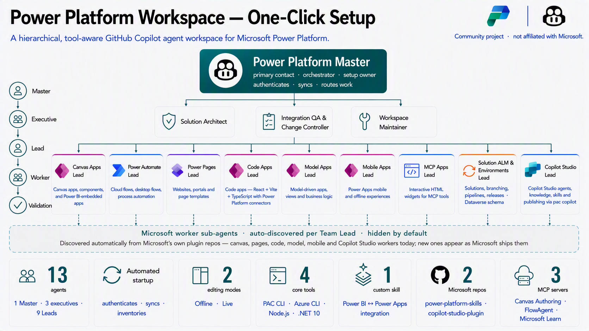

# Power Platform Workspace — One-Click Setup

[](https://github.com/SteCiu01/Power-Platform-Workspace-One-Click-Setup/releases)
[](https://github.com/SteCiu01/Power-Platform-Workspace-One-Click-Setup/actions/workflows/validate.yml)

Pre-release — used daily by the maintainer in real Power Platform work, evolving fast.
Contributions and feedback welcome.

**Bootstrap a Power Platform-ready Copilot agent workspace for VS Code.**

> **The 30-second version**
> - **What** — a one-click installer that scaffolds an opinionated Microsoft Power Platform development workspace in VS Code.
> - **Who it's for** — anyone building on Power Platform (canvas apps, cloud flows, Power Pages, code / model-driven / mobile apps, MCP widgets, Copilot Studio agents, solutions and Dataverse) who wants Copilot agents that already know the official skills, the right CLIs and the safe way to touch an environment.
> - **How to run** — double-click `Setup-PowerPlatformWorkspace.bat`, type a folder name, press Enter a few times.
> - **What you get** — a numbered 13-agent organisation (1 Master, 3 executives, 9 Team Leads) plus Microsoft's own worker agents auto-discovered as hidden sub-agents, two Microsoft vendor skill repos (`power-platform-skills`, `copilot-studio-plugin`), one custom skill, three MCP servers (live canvas, live flows, Microsoft Learn docs), a safety-checked `pac` helper and governed DEV → TEST → PROD rules.

> Windows installer (PowerShell + `.bat`); the workspace itself is OS-agnostic once created.

<p align="center">
  
</p>

---

## Contents

**Part 1 — Install it** *(what you actually do)*
- [1.1 Before you start — checklist](#11-before-you-start--checklist)
- [1.2 What the installer puts on your machine](#12-what-the-installer-puts-on-your-machine)
- [1.3 Get the two files](#13-get-the-two-files)
- [1.4 The installer, step by step (8 steps)](#14-the-installer-step-by-step-8-steps)
- [1.5 Your first session](#15-your-first-session)
- [1.6 Updating (re-run the same installer)](#16-updating-re-run-the-same-installer)
- [1.7 Troubleshooting](#17-troubleshooting)

**Part 2 — Use it** *(how you work day to day)*
- [2.1 How a request flows through the team](#21-how-a-request-flows-through-the-team)
- [2.2 Two ways of editing — offline and live](#22-two-ways-of-editing--offline-and-live)
- [2.3 Day-to-day commands](#23-day-to-day-commands)
- [2.4 Solutions, environments and the Production gate](#24-solutions-environments-and-the-production-gate)
- [2.5 Live authoring — what needs setup from you](#25-live-authoring--what-needs-setup-from-you)
- [2.6 Runtimes and MCP servers — what each unlocks](#26-runtimes-and-mcp-servers--what-each-unlocks)
- [2.7 Workspace structure](#27-workspace-structure)
- [2.8 FAQ](#28-faq)

**Part 3 — Understand it** *(background and reference)*
- [3.1 Why this exists](#31-why-this-exists)
- [3.2 What this is / is not](#32-what-this-is--is-not)
- [3.3 The agent organisation](#33-the-agent-organisation)
- [3.4 Dynamic worker sub-agent discovery](#34-dynamic-worker-sub-agent-discovery)
- [3.5 Skills — where they come from](#35-skills--where-they-come-from)
- [3.6 Agentic design principles](#36-agentic-design-principles)
- [3.7 How it works under the hood](#37-how-it-works-under-the-hood)
- [3.8 Quality & validation](#38-quality--validation)
- [3.9 Current status (v0.5.1)](#39-current-status-v051)
- [3.10 Disclaimer](#310-disclaimer)
- [Contributing](#contributing) · [Files in this repository](#files-in-this-repository) · [License](#license)

---

# Part 1 — Install it

## 1.1 Before you start — checklist

The installer **stops** only if Git or VS Code is missing. Everything else it **installs for you where it can** and otherwise prints a warning and continues — nothing optional ever blocks setup.

| | Item | Who installs it | Notes |
|---|---|---|---|
| ✅ Required | **VS Code 1.117.0+** | You — [code.visualstudio.com](https://code.visualstudio.com) | Older builds have known bugs that break Copilot agent tools. Version is checked. |
| ✅ Required | **Git** | You — [git-scm.com](https://git-scm.com) | Also clones the two Microsoft vendor repos (no npm, no admin). Set `user.name` / `user.email` or the first commit is skipped. |
| ✅ Required | **GitHub Copilot + Agent Mode** | You — VS Code marketplace | `chat.agent.enabled`; org tenants may need admin. The installer can only *inform* if it cannot see it. |
| 🤖 Auto | **Power Platform CLI `pac`** | Installer | .NET global tool if a .NET SDK exists, otherwise the official per-user MSI (no admin). `pac copilot` needs **2.9.3+**. |
| 🤖 Auto | **[Power Platform Tools](https://marketplace.visualstudio.com/items?itemName=microsoft-IsvExpTools.powerplatform-vscode) extension** | Installer | Visual auth / environment panels. Optional; agents work without it. |
| 🤖 Auto | **.NET 10 SDK** (`dnx`) | Installer (per-user, no admin) | Runs the **Canvas Authoring MCP** for live canvas coauthoring. Offline canvas editing works without it. |
| 🤖 Auto | **Node.js 18+** | Installer (winget LTS) | Runs the **Power Automate FlowAgent MCP**. Code apps and mobile apps need **22+** — those Leads check `node --version` first. |
| 🤖 Auto | **Azure CLI `az`** | Installer (winget, else isolated venv) | `az login` authenticates the FlowAgent MCP; also resolves live Power Apps `appId`s during a Power BI repoint. |

> **Offline authoring needs only `pac`.** The 🤖 runtimes power live canvas / flow authoring; if a corporate policy blocks one, the Lead falls back to the offline pac path and says so.

## 1.2 What the installer puts on your machine

> [!WARNING]
> It is **not** just a folder creator. Read once, then run it with confidence.

**In your chosen workspace folder**
- Installer-managed files: 13 agent definitions + hidden worker wrappers, 1 custom skill, `copilot-instructions.md`, `AGENTS.md`, `.vscode/` settings / tasks / `mcp.json`, `.github/agent-docs/` (status script, flow docs, `tool-status.json`), `scripts/pac-workflows.ps1`, a `<folder>.code-workspace`, `.gitignore`.
- Two public Microsoft clones (gitignored): [`microsoft/power-platform-skills`](https://github.com/microsoft/power-platform-skills) and [`microsoft/copilot-studio-plugin`](https://github.com/microsoft/copilot-studio-plugin). Already present → force-refreshed to upstream.
- Empty `exports/`, `deploy/`, `scripts/` folders.
- Git: a new repo gets an initial commit; an existing repo gets a commit limited to installer-owned paths (your own staged work is left exactly as it was).

**On your system** — exactly the 🤖 rows above, nothing else. Git, VS Code and Copilot are yours to install.

**Never touched** — your `<Env>/<Solution>/` folders, exports, personal files, unrelated Git work, live environments.

## 1.3 Get the two files

Keep them together in one folder (as in [power-platform-workspace-installer](https://github.com/SteCiu01/Power-Platform-Workspace-One-Click-Setup/tree/main/power-platform-workspace-installer)):

```
Setup-PowerPlatformWorkspace.bat    ← double-click this
Setup-PowerPlatformWorkspace.ps1    ← the engine (called by the .bat)
```

The `.bat` runs the `.ps1` with a process-scoped `-ExecutionPolicy Bypass`, so the usual script-policy block does not apply. Application allowlisting can still stop it.

## 1.4 The installer, step by step (8 steps)

Each step prints a banner `STEP n of 8 - <title>`; the interactive ones end with `Press Enter to continue...`.

| Step | What you see | What to answer | What happens |
|---|---|---|---|
| **1 — Workspace Configuration** | `Enter a name for your workspace folder (default: Power Platform)` | a name, or Enter | Folder is created under your user profile. If it already exists you get `Continue with update? (y/n)` → **update mode**. |
| **2 — Checking Prerequisites** | green checks / yellow warnings | nothing (Enter at the end) | Git, VS Code ≥ 1.117 (stop if missing), git identity, `pac` (auto-install), Copilot (inform), Power Platform Tools (auto), .NET 10 SDK (auto), Azure CLI (auto), Node.js (auto). Warnings are collected and printed once. |
| **3 — Creating Folder Structure** | created paths | Enter | `exports/`, `deploy/`, `scripts/`, `.github/agents`, `.github/agent-docs`, `.github/skills/...`, `.vscode`. |
| **4 — Microsoft Vendor Repositories** | clone / refresh lines per repo | nothing | Clones `power-platform-skills` and `copilot-studio-plugin`; existing clones are **force-refreshed** (local edits auto-stashed, stash name printed). Success is claimed only when `HEAD` equals the upstream commit. |
| **5 — Generating Configuration Files** | one line per file | Enter at the end | `.gitignore`, `pac-workflows.ps1`, `copilot-instructions.md`, `AGENTS.md`, the 13 agents, **worker discovery** (hidden `0NN-sub-*` wrappers from both clones), status script, flow docs, the custom skill, `tasks.json`, `settings.json` + `mcp.json` (merged — your keys survive, JSONC comments preserved as a `.bak`), `<folder>.code-workspace`. |
| **6 — Workspace Guidance and Integrity** | manifest + self-test lines | nothing | `tool-status.json`, SHA-256 `installed-manifest.json` (+ `vendorCommits`), self-prune of files older versions shipped, self-test → `guardrail-status.json`. |
| **7 — Initializing Git Repository** | commit summary | nothing | `git init` if needed; initial commit, or an **isolated-index** update commit of installer-owned paths only. Skipped with a warning if git identity is unset. |
| **8 — Launching VS Code** | `Press Enter to open VS Code and finish setup...` | Enter | Opens the `<folder>.code-workspace` (keeps Lead → worker dispatch on even in a multi-root window). |

## 1.5 Your first session

1. VS Code opens from the `<folder>.code-workspace`.
2. Open **Copilot Chat** (`Ctrl+Shift+I`).
3. Select **000 - Power Platform Master** from the agent dropdown.
4. Say what you need (or just "hi").

> [!IMPORTANT]
> **How you open the folder matters.** `chat.subagents.allowInvocationsFromSubagents` (lets Team Leads dispatch their workers) is *window-scoped*: in a window opened from a `.code-workspace` file, VS Code ignores the folder's `.vscode/settings.json` for it.
>
> | You open the folder via… | Result |
> |---|---|
> | The shipped `<folder>.code-workspace` (what the installer opens) | ✅ full Master → Lead → Worker dispatch |
> | **File > Open Folder** | ✅ `.vscode/settings.json` applies |
> | **Your own** multi-root `.code-workspace` | ❌ unless you copy the setting into its `"settings"` block — Leads silently cannot dispatch |

On your first message the Master runs **one** status script and shows **one** block:

| Line | Meaning |
|---|---|
| Skills | Commit date of each vendor clone, how far behind upstream, whether a clone **moved since the agents were generated** (→ "re-run the installer"), custom skill date. Maintenance is hinted, never forced. |
| Config | Skill folders registered in `chat.agentSkillsLocations` (new upstream folders self-register) and whether nested dispatch is on. |
| Identity / Env | Active `pac auth` profile and environment (`az` as fallback). Sign-in is requested **only if the task needs an environment** — local edits, reviews and planning never block on it. |
| Tools | Live re-check of git / pac / dnx / node / az; refreshes `tool-status.json`. |

Then it routes your request. You never switch agent for normal work; the only optional switch is the **Run workspace maintenance** handoff.

## 1.6 Updating (re-run the same installer)

1. [Download the latest two files](https://github.com/SteCiu01/Power-Platform-Workspace-One-Click-Setup/tree/main/power-platform-workspace-installer).
2. Double-click the `.bat`, enter the **same folder name** → `Continue with update? (y/n)` → **y**.
3. Same 8 steps. Reopen VS Code / **Developer: Reload Window**.

**The five update rules** (the installer is the source of truth for what it ships):

| # | Rule | Means for you |
|---|---|---|
| 1 | Vendor clones are force-refreshed to upstream | **Don't edit** `power-platform-skills/` or `copilot-studio-plugin/`; edits are stashed (`git -C <repo> stash list`), not kept. |
| 2 | Installer-managed files are overwritten | **Don't hand-edit** `.github/agents/*`, `.github/skills/*`, `copilot-instructions.md`, `AGENTS.md`, `scripts/pac-workflows.ps1`, the flow docs. Add **new** files under `.github/` instead — they are never touched. |
| 3 | Config files are merged, not replaced | `settings.json`, `mcp.json`, `<folder>.code-workspace`: your keys survive; only the installer-required keys are re-asserted. A file that cannot be parsed is left alone and reported. A renamed folder carries the old workspace file's settings over. |
| 4 | Obsolete installer files are purged | Strict `old − new` diff over `installed-manifest.json`, never a folder sweep; the deletions are committed. |
| 5 | Your work is never touched | Solutions, exports, personal files, your staged Git changes. |

> **Shared workspace?** Re-run periodically even without a release — update mode re-pulls both Microsoft repos and regenerates the worker roster from them.

## 1.7 Troubleshooting

**Team Leads return nothing / the Master says workers can't be dispatched.** You opened VS Code from your own `.code-workspace` without the setting. Add `"chat.subagents.allowInvocationsFromSubagents": true` to its `"settings"` block, then **Developer: Reload Window**. The status block names the cause.

**Agent dropdown is stale after an update.** **Developer: Reload Window**.

**Status block says a clone moved since the agents were generated.** The Maintainer refreshed a vendor repo (or you did). Re-run the installer so the hidden workers and skill lists match the new upstream.

**`pac` not found right after install.** Open a new terminal (PATH refresh) and re-run; if it still fails the Master guides the install on first run.

**`dnx` / `node` / `az` failed to install on a locked-down PC.** Not blocking: offline authoring works. Install from the link in the warning, open a new terminal, re-run the installer to enable live authoring. Or select **003 - Workspace Maintainer** and name the tool.

**`push` says "Label 'X' is not mapped to an environment".** By design — the helper refuses to import into "whatever profile is active". Add the label to `.github/agent-docs/environments.json` (see [2.4](#24-solutions-environments-and-the-production-gate)) or pass `-EnvironmentUrl`.

**I want to check the workspace wasn't tampered with.** `Setup-PowerPlatformWorkspace.ps1 -VerifyRoot <folder>` re-hashes managed files and checks the required config values against `installed-manifest.json`.

---

# Part 2 — Use it

## 2.1 How a request flows through the team

Every request is delivered *through* the organisation; the Master never edits an artifact itself.

| Loop | When | Path |
|---|---|---|
| **Simple** | one team, one artifact | Master → Team Lead → (worker) → Lead validates → Master → you |
| **Designed** | cross-type or a design change | Master → **001 Architect** (PLAN) → Team Lead(s) in plan order → **002 QA** (VERDICT) → Master → you |
| **Blocked** | approval / input / design question mid-work | worker → Lead relays → Master asks **you** → re-dispatch with the answer |

Every hop uses the same **WORK ORDER** (goal, artifact, mode, constraints, expected validation, approvals granted, context) and **WORK RESULT** (`DONE | DONE WITH RISKS | NEEDS APPROVAL | NEEDS INPUT | NEEDS ARCHITECT | OUT OF SCOPE | FAILED`) contract, defined in `.github/agent-docs/working-flow-reference.md`. Only the agent *you* selected can talk to you; everyone else bubbles questions up. Same vocabulary as the [Fabric twin](https://github.com/SteCiu01/Fabric-Agentic-Workspace-One-Click-Setup).

**Destructive work needs a token.** Deleting or dropping any app, screen, control, flow, table, column, form, view, page, file or branch, overwriting local source with an export, importing into a shared environment, publishing a Copilot Studio agent — all destructive even if you asked in plain words. The Master states exactly what will happen and asks for `APPROVED:<ACTION>:<artifact>`; **Production imports need you to type `confirm push to prod`**. Workers without the token stop and return `NEEDS APPROVAL`.

## 2.2 Two ways of editing — offline and live

Both are first-class; the Lead picks by component type.

**Offline (solution-bound, the default)** — needs only `pac`. Pull the solution (export → unpack into `<Env>/<Solution>/`), edit the unpacked source following the owning `SKILL.md`, review `git diff`, pack → import (token required). Changes appear in the platform after import + refresh.

**Live (plugin runtime)** — edits land in the running environment, no pack/import. Canvas apps through the **Canvas Authoring MCP** against an open Studio tab; cloud flows through the **FlowAgent MCP**; code apps, mobile apps, Pages code sites and Copilot Studio agents through their own CLI flows. Live changes are not in git until the solution is pulled again — the Lead says so.

| Component | Offline (pac solution) | Live / own CLI |
|---|---|---|
| Canvas app | ✅ `.pa.yaml` in the unpacked solution | ✅ `canvas-authoring` MCP (.NET 10, open Studio tab) |
| Cloud flow | ✅ `definition.json` | ✅ `flow-agent` MCP (Node 18+, `az login`) |
| Model-driven forms / views / sitemap | ✅ XML | — |
| Generative pages (model-apps) | packaged by the genpage flow | ✅ genpage CLI |
| Code app | source in its own repo | ✅ `npx --no-install pa` (Node 22+) |
| Mobile app (Expo) | source in its own repo | ✅ Expo / mobile CLI flow (Node 22+) |
| Power Pages site | ✅ `pac pages` + solution for tables | ✅ code-site tooling |
| Copilot Studio agent (MCS2) | classic agents only | ✅ `pac copilot` workspace: init / clone → edit YAML → pull / push; publish gated |
| Dataverse tables / columns | ✅ solution XML (token) | — |

## 2.3 Day-to-day commands

Plain English to the Master. Solution & environment management:

| Command | What happens |
|---|---|
| `pull MyApp` | Export + unpack into `<Env>/MyApp/`, commit (overwriting local edits needs `APPROVED:OVERWRITE:<env>/MyApp`) |
| `push MyApp to TEST` | Pack + import + commit (`APPROVED:IMPORT:TEST/MyApp`; PROD needs `confirm push to prod` + a QA VERDICT) |
| `sync DEV` | Lists **unmanaged, non-Microsoft** solutions and pulls the ones you pick — never "everything" (`APPROVED:SYNC:<env>` for more than one) |
| `new solution InventoryTracker` | `pac solution init` scaffold |
| `compare DEV and TEST` | Pulls the same solution from both and diffs |
| `status` | Auth state, solution list, git log |
| `create a Copilot Studio agent …` | 090 Lead: `pac copilot init` → Microsoft's Architect writes the YAML → push; publish only with your token |
| `run maintenance` | Refreshes both vendor clones + tool inventory (also a handoff button) |

Building and editing components:

| Example request | What happens |
|---|---|
| `add a text input and a submit button to the Contact screen in MyApp` | Canvas Lead edits the `.pa.yaml` (or live, if you connected a Studio tab) following the canvas-apps skill, shows a diff |
| `create a generative page for the Account table in my model-driven app` | Model Apps Lead runs Microsoft's genpage planner / builders and deploys via `pac` |
| `add a condition to my approval flow that emails when status is Rejected` | Power Automate Lead edits the flow live via FlowAgent, or the unpacked JSON offline |
| `add a topic to my Copilot Studio agent for order-status questions` | Copilot Studio Lead pulls the MCS2 workspace, has Microsoft's Architect add the behaviour per the plugin's YAML schemas, pushes, asks for your token before publishing |
| `add a 'Priority' choice column to the Task table` | ALM Lead edits the entity XML in `Other/` and flags the publish step |

> **Scope note:** every component above is guided by official Microsoft skills from the two cloned repos, except **Dataverse schema**, which has no dedicated skill yet and is edited from unpacked XML. Always review diffs before pushing.

## 2.4 Solutions, environments and the Production gate

`scripts/pac-workflows.ps1` is the helper the ALM Lead uses for `pull` / `push` / `init`. Its safety contract:

- **The label must map to a URL.** `-Environment DEV` is a folder label; for pull/push it must resolve through the user-owned map `.github/agent-docs/environments.json` or an explicit `-EnvironmentUrl`. Unmapped → refused (exit 5). It never silently uses the active `pac` profile.

  ```json
  { "DEV":  { "url": "https://orgdev.crm.dynamics.com",  "production": false },
    "TEST": { "url": "https://orgtest.crm.dynamics.com", "production": false },
    "PROD": { "url": "https://orgprod.crm.dynamics.com", "production": true } }
  ```
- **The active org must equal that URL** (`pac org who`, exit 4 otherwise) and is pinned with `--environment` on every remote command.
- **Production is classified from the map** (`production: true`), not from the word "prod". A Production push needs `-ConfirmProd` (exit 2) — the agents only pass it after you type `confirm push to prod`.
- Every `pac` / `git` step is exit-code checked; the previous package is deleted before packing; after import the solution must appear by **exact unique name** in `pac solution list --json` (fails closed if the list cannot run).
- Paths are anchored to the workspace, not the caller's CWD; only the solution folder is committed — your own staged files stay staged.

Full command reference: [CLI-FUNCTIONALITIES.md](CLI-FUNCTIONALITIES.md).

## 2.5 Live authoring — what needs setup from you

Every "Live / own CLI" row in the matrix above is handled by its Lead against your environment. Most of them are **CLI-driven and need nothing from you** beyond a signed-in `pac` profile (and Node 22+ where noted): code apps (`npx --no-install pa`), mobile apps (Expo flow), Pages code sites (`pac pages` / code-site tooling), generative pages (genpage CLI) and Copilot Studio agents (`pac copilot init / clone / pull / push`, publish only with your token).

Two paths are **real-time MCP sessions** and do need a one-time step from you:

**Canvas (Canvas Authoring MCP, `dnx` / .NET 10).**
1. Open the app in **Power Apps Studio** in edit mode. 2. **Settings → Updates → Coauthoring** → on, save. 3. Keep the tab open. 4. Copy the Studio URL. 5. Tell the Master *"connect live canvas authoring"* and paste it. 6. Ask for changes — they land in the open tab. The MCP exposes more tools after a successful connect; "tool unavailable" almost always means *not connected yet*.

**Flows (FlowAgent MCP, Node 18+ + `az login`).**
1. Run `az login` once per session with your Power Platform account. 2. Select the Master (routes to the Power Automate Lead). 3. Make sure the right environment is selected. 4. Ask — the flow is built or edited live against your environment. 5. Review in make.powerautomate.com.

> If a runtime or session is missing, the Lead falls back to offline editing automatically and says so. Live changes of any kind are not in git until the solution is pulled again.

## 2.6 Runtimes and MCP servers — what each unlocks

| Tool | Who uses it | What it unlocks | Without it |
|---|---|---|---|
| `pac` | ALM, Copilot Studio, Master | Auth, environments, solution export/unpack/pack/import, `pac copilot` (2.9.3+) | — (required) |
| `dnx` (.NET 10) → **canvas-authoring MCP** | Canvas Apps | Real-time coauthoring in an open Studio tab | Offline `.pa.yaml` editing |
| `node` 18+ → **flow-agent MCP** | Power Automate | Live cloud-flow authoring against the environment | Offline `definition.json` editing |
| `az` | Power Automate, Canvas (repoint) | `az login` for FlowAgent; resolves live `appId`s for the Power BI repoint | Manual IDs |
| **microsoft-learn MCP** (HTTP) | Architect + every Lead | Current Microsoft documentation, nothing to install | Model knowledge |
| Node 22+ / npm 10+ | Code Apps, Mobile Apps | `npx --no-install pa`, Expo SDK 55 | Those tasks stop and ask for an upgrade |

Routing is always by **topic**; a missing tool never changes the owner. `tool-status.json` records `found` / `command` / `path` per tool and is refreshed at every session start.

## 2.7 Workspace structure

```
Power Platform/
├── .github/
│   ├── agents/
│   │   ├── 000-power-platform-master.agent.md        ← entry point / coordinator
│   │   ├── 001-solution-architect.agent.md           ← PLAN (read-only)
│   │   ├── 002-integration-qa-change-controller.agent.md ← VERDICT + Prod gate
│   │   ├── 003-workspace-maintainer.agent.md         ← vendor clones, config, drift
│   │   ├── 010-… 090-…-lead.agent.md                 ← nine Team Leads
│   │   └── 0NN-sub-*.agent.md                        ← Microsoft workers (hidden, auto-discovered)
│   ├── agent-docs/
│   │   ├── Get-SessionStatus.ps1                      ← one-call session status
│   │   ├── starting-flow.md · working-flow-reference.md
│   │   ├── environments.json                          ← YOUR label → URL / production map
│   │   └── tool-status.json · guardrail-status.json   ← machine-specific (gitignored)
│   ├── skills/pbi-powerapps-integration/SKILL.md      ← custom embedded skill
│   ├── copilot-instructions.md
│   └── installed-manifest.json                        ← SHA-256 + vendorCommits (-VerifyRoot)
├── .vscode/  (settings.json, mcp.json, tasks.json)
├── AGENTS.md
├── Power Platform.code-workspace                      ← open VS Code from here
├── scripts/pac-workflows.ps1                          ← safety-checked pull / push / init
├── exports/  deploy/                                  ← raw zips (gitignored) / packed zips
├── power-platform-skills/                             ← Microsoft Power Platform skills (gitignored)
│   └── plugins/{canvas-apps, power-automate, power-pages, code-apps, model-apps,
│                mobile-apps, power-apps-mobile-extension, mcp-apps}
├── copilot-studio-plugin/                             ← Microsoft Copilot Studio plugin (gitignored)
│   ├── agents/   skills/   reference/
└── <Env>/<Solution>/                                  ← unpacked solution source
```

## 2.8 FAQ

**Can I move the workspace folder?** Yes. Re-run the installer there once so the `.code-workspace` and the absolute status-script path follow it (settings carry over).

**macOS / Linux?** The installer is Windows-only; the workspace works on any OS once created.

**Why git clone instead of npm?** Git is already required; npm global installs usually need admin on corporate machines.

**Can I add my own agents / skills?** Yes — new files under `.github/` are never overwritten or purged.

**How do I update skills?** `run maintenance` (Maintainer mirrors both clones) and re-run the installer when the status block says a clone moved.

**Can a team share the workspace via git?** Yes. Clones, exports and machine-specific files are gitignored; each member re-runs the installer locally.

**What do I need for live authoring?** .NET 10 SDK (canvas) and Node 18+ + `az login` (flows) — auto-installed. Offline needs only `pac`.

**Does the agent ever touch Production on its own?** No. The helper refuses unmapped targets, classifies Production from your map and requires `-ConfirmProd`, which the agents pass only after you type `confirm push to prod`.

---

# Part 3 — Understand it

## 3.1 Why this exists

This is a personal project — and like most personal projects, it started from a real frustration.

I was doing a lot of bulk work across Power Platform: flows in **Power Automate**, apps in **Power Apps**, agents in **Copilot Studio**, all tied together through **solutions and Dataverse**. On the data side of the Microsoft stack, the [Fabric](https://marketplace.visualstudio.com/items?itemName=fabric.vscode-fabric) VS Code extensions already gave me a terminal-driven, agentic workflow; I wanted the same for Power Platform. [Power Platform Tools for VS Code](https://marketplace.visualstudio.com/items?itemName=microsoft-IsvExpTools.powerplatform-vscode) brings the PAC CLI and auth panels, but the general Copilot agent did not know Microsoft's Power Platform skills out of the box.

So I built a custom agent that set me up at the start of every session. One generalist soon hit its limits — canvas apps, cloud flows, Copilot Studio, model-driven pages and Dataverse schema each have their own conventions — so it became an **agentic team**: a Master that routes, specialist Team Leads that go deep on one area each, executives for planning, quality-gating and upkeep, and — since Microsoft started shipping its own worker agents inside its skill repos — those workers plugged in automatically under each Lead. Then I thought: *this should be replicable*. So it became a one-click installer.

## 3.2 What this is / is not

**Is:** a VS Code workspace bootstrapper for Power Platform developers · a GitHub Copilot Chat / Agent Mode configuration bundle · a `pac`-first accelerator with optional live MCP tooling · a repeatable package of the maintainer's real-world workflow.

**Is not:** an official Microsoft product · a hosted service · a Copilot CLI / Claude Code plugin distribution (Microsoft's plugins are cloned as read-only references the agents translate at runtime) · a replacement for solution ALM review or governance · a guarantee that AI edits are correct without human review.

## 3.3 The agent organisation

You normally only talk to **000 - Power Platform Master**. **Tools legend:** Delegate · Read · Search · Run · Edit.

| # | Agent | Owns | Tools | Skills / MCP |
|---|---|---|---|---|
| **000** | **Power Platform Master** | Startup, classification, routing, one consolidated answer, session ledger. Never implements. | Delegate · Read · Search · Run | routes via the Leads |
| **001** | **Solution Architect** | Cross-type design, solution/ALM shape, sequencing, rollback → **PLAN**. Read-only. | Delegate · Read · Search | microsoft-learn |
| **002** | **Integration QA & Change Controller** | Diffs, pack validation, cross-references, the Production gate → **VERDICT**. Verify only. | Read · Search · Run | — |
| **003** | **Workspace Maintainer** | Refreshes both vendor clones, config / MCP registrations, drift repair. Scaffolding only. | Read · Search · Run · Edit | — |
| **010** | **Canvas Apps Lead** | `.pa.yaml` offline + live coauthoring; Power BI-embedded apps; repoint | all five | `canvas-apps`, `pbi-powerapps-integration` · **MCP** canvas-authoring |
| **020** | **Power Automate Lead** | Cloud / desktop flows, live via FlowAgent | all five | `power-automate` · **MCP** flow-agent |
| **030** | **Power Pages Lead** | Sites and code sites (React / Angular / Vue / Astro) | all five | `power-pages` |
| **040** | **Code Apps Lead** | React + Vite + TypeScript code apps (`npx --no-install pa`, Node 22+) | all five | `code-apps` |
| **050** | **Model Apps Lead** | Generative pages, forms, views, sitemap | all five | `model-apps` |
| **060** | **Mobile Apps Lead** | Expo / React Native apps, offline profiles, `.ppmplugin` extensions | all five | `mobile-apps`, `power-apps-mobile-extension` |
| **070** | **MCP Apps Lead** | MCP App widgets | all five | `mcp-apps` |
| **080** | **Solution ALM & Environments Lead** | Export / unpack / pack / import, publishers, environments, promotion; Dataverse schema | all five | `pac-workflows.ps1`, Pages ALM skills as examples |
| **090** | **Copilot Studio Lead** | MCS2 agents via `pac copilot`: init / clone / pull / push / publish, knowledge, agent skills; publish / delete gated | all five | `copilot-studio-plugin` (Architect / Describer / Init / Manage workers) |

Every Lead can escalate to the Architect (design question) and QA (acceptance / Prod gate). Each agent is generated from a **knowledge catalog**: curated skill refs resolved against the real clones at install time, auto-matched upstream skills (scoped to its own plugins), a Playbook, the validation it must run, a tool ladder and an Avoid list. Every Lead also gets a `## Your team` roster of its discovered workers.

## 3.4 Dynamic worker sub-agent discovery

Microsoft ships **worker agents** inside its repos — `power-platform-skills/plugins/<plugin>/agents/*.md` (planners, screen builders, data-model architects …) and `copilot-studio-plugin/agents/*.md` (Architect, Describer, Init, Manage). Rather than fork them, the installer **discovers them at every run** and writes one hidden wrapper per worker (`user-invocable: false`, name `0NN-<slug>` so same-named workers in two plugins never clash), wired into the owning Lead.

- The wrapper is a **pointer, not a copy**: it tells the sub-agent to read Microsoft's file verbatim and translates that runtime's vocabulary (`Task`, `AskUserQuestion`, `EnterPlanMode`, `TaskCreate`, `apply_patch`, `${PLUGIN_ROOT}`, `mcs-assistant:<skill>`) into this workspace's contract.
- It carries only the worker's **own** tools and MCP servers (parsed from Microsoft's `tools:`); a worker with no `tools:` key gets a bounded read / search / edit / execute set.
- New upstream workers appear on the next installer run; removed ones are pruned (filename prefix **and** body marker must match — your own `-sub-` agents are safe).
- The manifest records the clone commit each wrapper set came from (`vendorCommits`); the status script flags drift after a maintenance refresh.

Today six Leads light up (canvas, pages, code, model, mobile — 20 workers — plus Copilot Studio's 4); the others activate the moment Microsoft adds an `agents/` folder.

## 3.5 Skills — where they come from

| Source | Covers | Updated |
|---|---|---|
| **Custom embedded** — `.github/skills/pbi-powerapps-integration` *(original to this repo)* | Canvas apps embedded in Power BI: `PowerBIIntegration.Data` / `.Refresh()`, the "re-edit from the Service" golden rule, 1000-row cap, stale-schema playbook, cross-environment **repoint** of Power Apps / Flow visuals per DevOps branch | Re-run installer |
| **Microsoft `power-platform-skills`** (MIT) | canvas-apps, power-automate (+ FlowAgent MCP), power-pages, code-apps, model-apps, mobile-apps, power-apps-mobile-extension, mcp-apps | Mirrored to upstream every run / `run maintenance` |
| **Microsoft `copilot-studio-plugin`** (MIT) | create / clone / pull / push / publish / delete-agent, add-knowledge, add-skill + authoritative YAML schemas in `reference/` | Mirrored to upstream every run / `run maintenance` |

Every skill folder is registered in `chat.agentSkillsLocations`, so agents see the whole catalogue natively. Before authoring, an agent reads the owning `SKILL.md` and only the references the current step needs (honouring the skill's own "read X only if Y" conditions). **Precedence:** custom wins on house style, upstream wins on syntax / spec.

## 3.6 Agentic design principles

| Principle | How the organisation applies it |
|---|---|
| **Bounded scope, one writer per artifact** | Master assigns exactly one Lead / worker per file or live object |
| **Deterministic tool gating** | `tool-status.json` checked first; the exact recorded `path` is invoked |
| **Graceful degradation** | Every live path has a documented offline fallback; a missing tool never changes the owner |
| **Minimum-necessary context** | Pinned skills per role, plugin-scoped discovery, lean worker contracts, task-relevant reads |
| **Lean, deterministic startup** | One status script; sign-in only when the task needs an environment |
| **Safety guardrails** | `APPROVED:<ACTION>:<artifact>` tokens; `confirm push to prod`; map-classified Production in code |
| **Resilient discovery** | Vendor renames matched by prefix; missing skills re-discovered by keyword; worker wrappers regenerated every run |
| **Reconcile before retry** | A dropped write-capable dispatch is inspected (`git diff`, `pac solution list`, `sync_canvas`) before anything is re-run |

## 3.7 How it works under the hood

`Setup-PowerPlatformWorkspace.ps1` is self-contained: every agent, doc, skill and config is embedded in the script. External content is limited to the two public Microsoft repos and the runtimes it installs. The `.bat` only supplies `-ExecutionPolicy Bypass`.

**Update mode** force-refreshes vendor clones (verified `HEAD` = upstream, renamed default branch followed), overwrites managed files, merges config, purges retired files via the manifest diff and commits only installer-owned paths from an isolated index.

**Dry-run / verification:** `-EmitAgentsTo <dir>` generates everything with no prerequisites, cloning or launch (used by the tests); `-VerifyRoot <folder>` re-hashes managed files and checks required config **values** (a key flipped to `false` is reported) against `installed-manifest.json`.

## 3.8 Quality & validation

- **JSON Schema** (`schema/agent-manifest.schema.json`) — shape of every manifest entry; validated in CI.
- **Pester suite** (`tests/`) — manifest integrity (13 agents, 4 / 9 tiers, unique ids), hierarchy, least-privilege tools, version / doc consistency (incl. the README test count), generated-file **content**, config merge robustness (JSONC, unparseable left alone, folder-rename migration), `-VerifyRoot` value checks, worker discovery for **both vendor layouts** (wiring, translation, pruning, collisions), vendor refresh failure doubles (`git.cmd` shim), and the emitted `pac-workflows.ps1` driven end-to-end with a fake `pac` (unmapped label, URL mismatch, map-classified Production, stale zip, exact-name verification, fail-closed list, scoped commit).
- **CI** (`.github/workflows/validate.yml`) — PowerShell 7 on every push / PR.
- **Install-time self-test + integrity manifest** — `guardrail-status.json`, SHA-256 `installed-manifest.json`.

Run locally: double-click `tests/Run-Tests.bat` (exit code = failed count), or
```powershell
powershell -NoProfile -ExecutionPolicy Bypass -Command "Import-Module Pester; Invoke-Pester -Path '.\tests' -Output Detailed"
```

Not covered: a full end-to-end install against a live tenant, and the *behavioural* quality of prompts — validated by real-world use (v0.5.0: live canvas add-control via Master → Lead → worker, a cross-type Architect PLAN, a plain-words delete correctly stopped at `NEEDS APPROVAL`).

## 3.9 Current status (v0.5.1)

| Area | Status |
|---|---|
| One-click setup (.bat + .ps1) | **Working** — Windows 10/11 |
| 13-agent hierarchy (Master → Architect / 9 Leads) | **Working** — generated from an embedded, schema-validated manifest |
| Copilot Studio department (090) + second vendor clone | **New in v0.5.1** — `pac copilot` skills registered natively, Microsoft's four workers auto-discovered, publish / delete gated |
| Dynamic Microsoft worker sub-agents | **Working** — both vendor layouts; wrappers mirror each worker's own tools; Leads carry a roster |
| Team protocol (WORK ORDER / RESULT, PLAN, VERDICT, tokens, ledger) | **Since v0.5.0** — shared with the Fabric twin |
| Nested dispatch (`allowInvocationsFromSubagents`) | **Since v0.5.0** — settings.json + shipped `.code-workspace`; checked by the status script |
| Lean session startup | **Since v0.5.0**, sign-in conditional on the task in v0.5.1 |
| Live canvas authoring (MCP) · Power Automate FlowAgent (MCP) · Microsoft Learn (MCP) | **Working** — runtimes auto-installed; offline fallback |
| PAC helper `scripts/pac-workflows.ps1` | **Hardened in v0.5.1** — mapped targets, map-classified Production, exact-name fail-closed verification, scoped commit |
| Vendor clone refresh | **Hardened in v0.5.1** — two clones from one table; `HEAD` = upstream or explicit failure; renamed default branch followed |
| Update commit + integrity model | **Fixed in v0.5.1** — isolated-index commit, value-checked config, JSONC merge, rename migration |
| Agent hand-offs | **Fixed in v0.5.1** — Leads can really reach Architect / QA; upstream worker vocabulary translated; reconcile-before-retry |
| Manifest + generator integrity (`-EmitAgentsTo` / `-VerifyRoot`, Pester + CI) | **Working** — 122 tests |

Pre-release: genuinely useful today, expect rough edges. [Open an issue](https://github.com/SteCiu01/Power-Platform-Workspace-One-Click-Setup/issues).

## 3.10 Disclaimer

This is a **personal and community project**, not an official Microsoft product and not affiliated with Microsoft; no guarantees of any kind.

**AI involvement:** built with significant help from **GitHub Copilot** — installer scripts, agent files, documentation and much of the heavy lifting. The core ideas, design decisions and testing are the maintainer's.

**Early stage — use with care:** pre-release. **Do not use against production environments without understanding what the scripts do.** Review the code before running it.

**Third-party dependencies:** the two cloned Microsoft repositories are independent open-source projects (MIT); this project has no control over their content or availability.

---

## Contributing

Feedback, ideas and improvements welcome — from typo fixes to new agent workflows to cross-platform support. See **[CONTRIBUTING.md](CONTRIBUTING.md)**.
[Report a bug](https://github.com/SteCiu01/Power-Platform-Workspace-One-Click-Setup/issues/new?template=bug_report.yml) · [Request a feature](https://github.com/SteCiu01/Power-Platform-Workspace-One-Click-Setup/issues/new?template=feature_request.yml) · [Open issues](https://github.com/SteCiu01/Power-Platform-Workspace-One-Click-Setup/issues)

## Files in this repository

| File | Purpose |
|---|---|
| `power-platform-workspace-installer/Setup-PowerPlatformWorkspace.bat` | Double-click entry point — share this with your team |
| `power-platform-workspace-installer/Setup-PowerPlatformWorkspace.ps1` | The full installer — same folder as the .bat |
| `CHANGELOG.md` | Version history |
| `CLI-FUNCTIONALITIES.md` | Per-CLI deep dive (`pac`, `pac copilot`, `dnx`, `node`, `az`) and the helper contract |
| `CONTRIBUTING.md` · `CODE_OF_CONDUCT.md` · `SECURITY.md` | Community and security |
| `schema/` · `tests/` | Manifest schema and Pester suite |
| `LICENSE` | MIT |

## License

MIT — see [LICENSE](https://github.com/SteCiu01/Power-Platform-Workspace-One-Click-Setup/blob/main/LICENSE).
